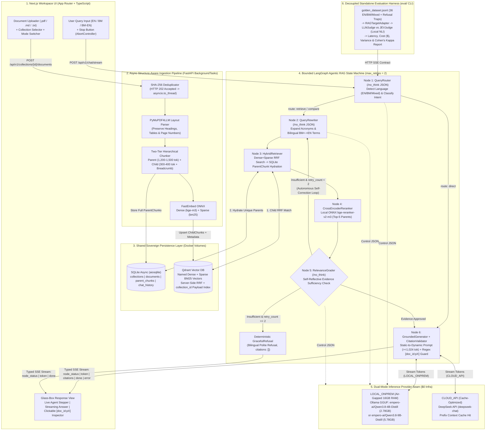

# Sovereign Agentic RAG (`sovereign-agentic-rag`)

**A zero-infrastructure-cost (`$0`), containerized, bilingual (EN / BM / BM-EN Code-Switching) Agentic RAG platform built for air-gapped on-premises sovereignty and cache-optimized cloud inference.**

> **Project Status:** **Phases 1–5 Complete** — Architecture & TDD specs (`docs/`), FastAPI layered backend Core + Qdrant Hybrid RRF + `PyMuPDF4LLM` ingestion + Seed Collections + Bounded 6-node LangGraph SSE engine (`backend/`, `38 passed`), and Standalone `LLMJudge` vs. `JEVJudge` evaluation harness (`eval/`, `14 passed`) are implemented and verified. Next: Phase 6 (Next.js Workspace UI) & Phase 7 (Docker Compose).

---

## Key Capabilities (Designed Architecture)

- **Collection-Isolated Multi-Tenant Workspaces:** Supports `.pdf`, `.md`, and `.txt` uploads with strict `collection_id`, `language`, and `doc_type` payload isolation, pre-seeded with:
  - **Collection A (`it_infra_sops`):** Enterprise IT & Server Infrastructure SOPs (hardware specs, NVMe/RAID runbooks, deployment SOPs).
  - **Collection B (`malaysian_enterprise_policy`):** Malaysian Enterprise Policy & Compliance (English, Bahasa Melayu, and BM-EN workplace code-switching).
- **Dual-Mode Inference Adapter (`LOCAL_ONPREM` $\leftrightarrow$ `CLOUD_API`):**
  - `LOCAL_ONPREM`: 100% air-gapped execution on 16GB RAM workstations using **Ollama / llama.cpp (`hf.co/empero-ai/Qwen3.8-4B-Distill-GGUF:Q4_K_M` [2.78 GB] default, or `hf.co/empero-ai/Qwen3.8-9B-Distill-GGUF:Q4_K_M` [5.78 GB] high-precision option via `LOCAL_LLM_MODEL`)**, **FastEmbed ONNX (`BAAI/bge-m3` + `Qdrant/bm25`)**, and an ONNX Cross-Encoder reranker.
  - `CLOUD_API`: **DeepSeek API** ordered strictly static-to-dynamic ($\ge 1,024$-token static prefix) to maximize **Prefix Context Caching** hit discounts.
- **Sub-10ms Qdrant Hybrid Search + Structure-Aware Ingestion:** Native Dense + Sparse BM25 vectors fused server-side via **Reciprocal Rank Fusion (RRF)**, fed by **`PyMuPDF4LLM`** and two-tier **`ParentChunk` / `ChildChunk` + `Breadcrumb`** chunking via non-blocking FastAPI `BackgroundTasks`.
- **Bounded LangGraph State Machine (`max_retries=2`):** 6 observable nodes (`QueryRouter` $\rightarrow$ `QueryRewriter` $\rightarrow$ `HybridRetriever` $\rightarrow$ `CrossEncoderReranker` $\rightarrow$ `RelevanceGrader` $\rightarrow$ `GroundedGenerator`) with `CitationValidator` (`[doc_id:pX]`) and deterministic bilingual `GracefulRefusal` (no external web search leakage).
- **Glass-Box Next.js Workspace & Typed SSE:** `POST /api/v1/chat/stream` emits 5 discriminated SSE events (`node_status`, `token`, `citations`, `done`, `error`) powering a live **Agent Execution Stepper** and clickable evidence drawers.
- **Standalone Evaluation Sub-Project (`eval/`):** Decoupled HTTP evaluation harness comparing generative **`LLMJudgeEvaluator`** vs. deterministic **`JEVJudgeEvaluator`** (`$0`, sub-100ms, `0.0` variance) across Latency, Token Cost, Score Variance, and Cohen's Kappa (`InterJudgeAgreement`).

---

## Engineering Progression: From `v1`/`v2` (`malay-qa-bot-rag`) to `v3` Production Architecture

This repository evolves the 2025 prototype [`amirulhazym/malay-qa-bot-rag`](https://github.com/amirulhazym/malay-qa-bot-rag) (`v1_malay_selfhosted` and `v2_multilingual_api`) into a production-ready enterprise architecture:

| Engineering Dimension | `v1_malay_selfhosted` (2025) | `v2_multilingual_api` (2025) | `sovereign-agentic-rag` (`v3` Target) |
| :--- | :--- | :--- | :--- |
| **Control Flow** | Linear `RetrievalQA` chain | Linear 1-shot `encode -> retrieve -> rerank -> generate` | **Bounded LangGraph State Machine** (`max_retries=2`) with self-reflective grading, query rewriting & `GracefulRefusal` |
| **Retrieval & Chunking** | Local FAISS + `MiniLM-L12-v2` + 300-char recursive split | Cloud Pinecone (pure dense cosine) + 1,000-char split (`Context Precision` plateaued at `0.336`) | **Qdrant Hybrid Search (Dense + Sparse BM25 via RRF)** + **`PyMuPDF4LLM` `ParentChunk`/`ChildChunk` + `Breadcrumb`** + `collection_id` isolation |
| **Backend & Transport** | Monolithic Streamlit script | Single-file FastAPI `main.py` (import-time model load, blocking `POST`, duplicated `v2_adapter.py`) | **Layered FastAPI** (`routers -> services -> agents -> repositories/providers`), `lifespan` + `Depends()`, async `BackgroundTasks`, **typed SSE** |
| **Frontend UI** | Streamlit | Streamlit polling `requests.post(..., timeout=30)` | **Next.js (App Router, TypeScript, Tailwind)** with live **Agent Execution Stepper**, mode switch, & clickable `[doc_id:pX]` citation cards |
| **Sovereignty & Cost** | Broken local `flan-t5-small` (`0.037` relevancy) | Cloud lock-in (Pinecone + Gemini) | **`$0` Infra Dual-Mode Adapter:** `LOCAL_ONPREM` (`empero-ai/Qwen3.8-4B/9B-Distill-GGUF` + FastEmbed ONNX) $\leftrightarrow$ `CLOUD_API` (DeepSeek Prefix Caching) |
| **Containerization** | Hugging Face Spaces SDK | Single container launching 2 processes via `sleep 20` | **Multi-stage Docker Compose** (`frontend`, `backend`, `qdrant`, `ollama` profile) with `service_healthy` probes & named volumes |
| **Evaluation** | Manual / Qualitative | Jupyter Notebook (`03-Evaluation-Framework.ipynb`) with RAGAs (`IndexError` / `NaN` failures) | **Standalone `eval/` CLI Harness** comparing **`LLM-as-a-Judge`** vs. **`JEV-as-a-Judge`** (Latency, Cost, Variance, Cohen's Kappa) |

---

## Unified End-to-End Agentic RAG System Architecture



---

## Documentation Index

- **[Product Requirements Document (`docs/PRD.md`)](docs/PRD.md)** — Problem statement, 22 user stories, locked specs, and 8 production edge-case mitigations.
- **[System Architecture & Reverse-Engineering Guide (`docs/Architecture.md`)](docs/Architecture.md)** — Component seams, SQLite & Qdrant schemas, LangGraph 6-node workflow, SSE contract, and *"Under the Hood"* deep dives.
- **[Design System (`docs/Design-System.md`)](docs/Design-System.md)** — UI tokens, 3-pane Glass-Box workspace layout, Agent Execution Stepper, and Evidence Inspector specs.
- **[Evaluation Sub-Project (`docs/Eval-Subproject.md`)](docs/Eval-Subproject.md)** — `BaseJudgeEvaluator` seam, `LLMJudge` vs. `JEVJudge` scoring algorithms, `golden_dataset.jsonl`, and Cohen's Kappa reporting.
- **[Standalone Evaluation Harness Guide (`eval/README.md`)](eval/README.md)** — Setup and CLI benchmark commands (`--runs 3`, `HTTPTargetAdapter`, ONNX NLI / DeepSeek / Ollama).
- **[Domain & Architecture Glossary (`GLOSSARY.md`)](GLOSSARY.md)** — Canonical project vocabulary.
- **[TDD Implementation Plan (`docs/superpowers/plans/2026-11-16-sovereign-agentic-rag.md`)](docs/superpowers/plans/2026-11-16-sovereign-agentic-rag.md)** — Task-by-task build roadmap (Phases 2–7).
- **[Agent Engineering Rules (`AGENTS.md`)](AGENTS.md)** — Architectural invariants, TDD discipline, and verification commands.

---

## Verified Local Suites (Phases 2–5)

```bash
# Backend unit, ingestion, LangGraph & SSE contract tests
cd backend && .venv/Scripts/pytest.exe tests -v && .venv/Scripts/ruff.exe check app tests

# Standalone eval harness tests & lint
cd eval && .venv/Scripts/pytest.exe tests -v && .venv/Scripts/ruff.exe check eval_harness tests
```

---

## Author

**Amirulhazym** — [GitHub](https://github.com/amirulhazym) · [Previous Prototype (`malay-qa-bot-rag`)](https://github.com/amirulhazym/malay-qa-bot-rag)
