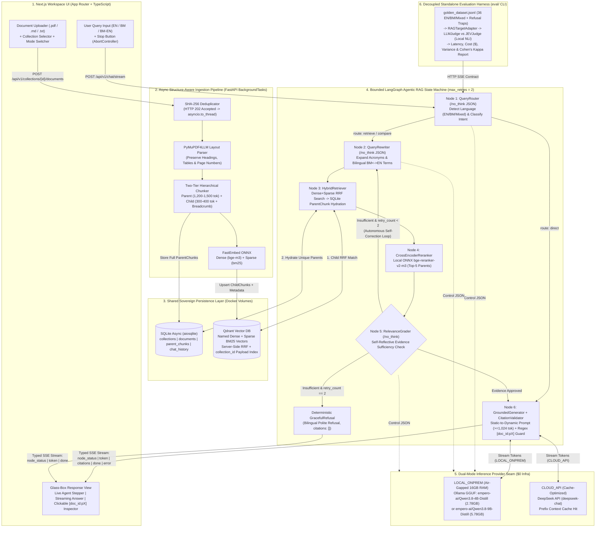
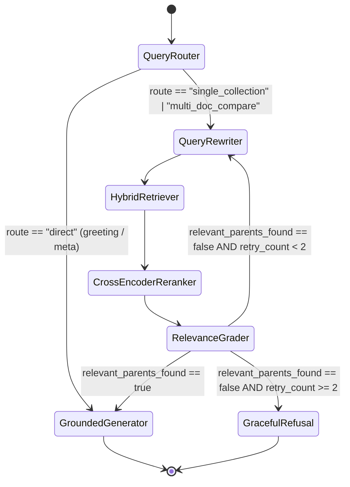

# System Architecture & Reverse-Engineering Guide: `sovereign-agentic-rag`

> **Audience:** Engineers implementing, reviewing, or reverse-engineering every layer of `sovereign-agentic-rag`.  
> **Vocabulary:** Canonical terms follow [GLOSSARY.md](../GLOSSARY.md).

---

## 1. Unified End-to-End Agentic RAG System Architecture

`sovereign-agentic-rag` integrates async document ingestion, sovereign hybrid persistence, a **bounded 6-node LangGraph agent loop**, dual-mode inference, typed SSE streaming, and standalone evaluation into a single cohesive end-to-end architecture at **$0 infrastructure cost**:

### 1.1 Whole-System End-to-End Architecture Diagram



### 1.2 ASCII End-to-End Pipeline Trace (User Query $\rightarrow$ Agentic Loop $\rightarrow$ User Response)

```text
[USER QUERY IN NEXT.JS]  ("Apa prosedur tuntutan OT kalau kerja public holiday?")
   │  POST /api/v1/chat/stream  (collection_id + InferenceMode + AbortController)
   ▼
[FASTAPI SSE ROUTER] ──► Opens HTTP 200 text/event-stream (X-Accel-Buffering: no)
   │
   ▼
┌──────────────────────────────────── LANGGRAPH BOUNDED AGENT LOOP (max_retries=2) ────────────────────────────────────┐
│                                                                                                                       │
│  [1. QueryRouter] (/no_think JSON) ──► emits SSE `node_status`                                                        │
│       ├─ route == "direct" ─────────────────────────────────────────────────────────────┐                             │
│       └─ route == "single_collection" | "multi_doc_compare"                             │                             │
│            ▼                                                                            │                             │
│  [2. QueryRewriter] (/no_think JSON) ◄────────────────────────┐                         │                             │
│       │  Expands BM <-> EN & acronyms (OT -> overtime /       │                         │                             │
│       │  kerja lebih masa); shifts query terms on retry       │                         │                             │
│       ▼                                                       │                         │                             │
│  [3. HybridRetriever] ──► FastEmbed (bge-m3 Dense + bm25)     │                         │                             │
│       │                   ──► Qdrant RRF (collection_id)      │  AGENTIC SELF-CORRECTION│                             │
│       │                   ──► SQLite ParentChunk Hydration    │  (retry_count < 2)      │                             │
│       ▼                                                       │                         │                             │
│  [4. CrossEncoderReranker] ──► ONNX bge-reranker-v2-m3 Top-5  │                         │                             │
│       ▼                                                       │                         │                             │
│  [5. RelevanceGrader] (/no_think JSON) ──► Sufficient? ───────┘ (NO & retries < 2)      │                             │
│       ├─ NO & retry_count == 2 ──► [Deterministic GracefulRefusal] (citations: []) ─────┼──► SSE `token` + `done`     │
│       └─ YES (Evidence Approved) ───────────────────────────────────────────────────────┘                             │
│            ▼                                                                                                          │
│  [6. GroundedGenerator] ──► Static Prefix (>=1,024 tok) + History + Sorted Parents + Question                         │
│       ├─ LOCAL_ONPREM: Ollama GGUF (empero-ai/Qwen3.8-4B-Distill:Q4_K_M or Qwen3.8-9B-Distill:Q4_K_M) + <think> strip │
│       └─ CLOUD_API:    DeepSeek API (deepseek-chat, Prefix Context Caching)                                           │
│            ▼  streams `event: token` + runs regex `CitationValidator` ([doc_id:pX])                                   │
└───────────────────────────────────────────────────────────────────────────────────────────────────────────────────────┘
   │
   ▼  emits `event: citations` + `event: done` (cache_hit_tokens, latency_ms) & persists to SQLite
[NEXT.JS WORKSPACE UI]  Renders Live Agent Stepper + Streaming Answer + Clickable [doc_id:pX] Evidence Drawer
```

---

## 2. Repository Directory Structure

```text
sovereign-agentic-rag/
├── AGENTS.md                           # Strict rules, CLI commands, and TDD workflow
├── GLOSSARY.md                         # Canonical domain & deep-module vocabulary
├── README.md                           # Portfolio overview & v1/v2 -> v3 progression
├── docker-compose.yml                  # Orchestrates frontend, backend, qdrant, ollama profile
├── .env.example                        # Template environment variables (zero secrets)
├── .gitignore
├── data/
│   └── seed_collections/
│       ├── it_infra_sops/              # Collection A: IT & Server Infrastructure SOPs
│       └── malaysian_enterprise_policy/# Collection B: MY Policy & Compliance (EN/BM/Mixed)
├── docs/
│   ├── PRD.md                          # Product requirements, user stories, locked specs
│   ├── Architecture.md                 # This document + Under the Hood guide
│   ├── Design-System.md                # Next.js UI tokens, 3-pane layout, stepper specs
│   ├── Eval-Subproject.md              # LLM-as-a-Judge vs JEV-as-a-Judge design
│   └── superpowers/
│       └── plans/
│           └── 2026-11-16-sovereign-agentic-rag.md
├── backend/
│   ├── Dockerfile                      # Multi-stage slim Python 3.11+ build
│   ├── pyproject.toml
│   ├── app/
│   │   ├── main.py                     # FastAPI factory, lifespan, CORS, Swagger /docs
│   │   ├── core/
│   │   │   ├── config.py               # Pydantic BaseSettings (.env & runtime overrides)
│   │   │   ├── exceptions.py           # Structured JSON error envelope & handlers
│   │   │   └── dependencies.py         # FastAPI Depends() wiring (no import side effects)
│   │   ├── schemas/                    # Pydantic v2 request/response & SSE schemas
│   │   ├── repositories/
│   │   │   ├── sqlite_repo.py          # Async SQLAlchemy/aiosqlite persistence
│   │   │   └── qdrant_repo.py          # Qdrant Hybrid (Dense+Sparse RRF) + InMemoryFake
│   │   ├── providers/
│   │   │   ├── base.py                 # LLMProvider, EmbeddingProvider, RerankerProvider
│   │   │   ├── local_onprem.py         # Ollama + FastEmbed (ONNX) + ONNX Cross-Encoder
│   │   │   └── cloud_deepseek.py       # DeepSeek API with Prefix Context Caching layout
│   │   ├── services/
│   │   │   ├── ingestion.py            # PyMuPDF4LLM, Parent-Child + Breadcrumb, SHA-256
│   │   │   ├── chat_service.py         # Orchestrates session history + LangGraph SSE stream
│   │   │   └── seeder.py               # Idempotent Collection A & B seeding
│   │   ├── agents/
│   │   │   ├── state.py                # RAGGraphState TypedDict/Pydantic definition
│   │   │   ├── nodes.py                # 6 LangGraph nodes + CitationValidator + Refusal
│   │   │   └── graph.py                # Compiled bounded StateGraph (max_retries=2)
│   │   └── api/
│   │       └── v1/routers/             # health.py, collections.py, documents.py, chat.py
│   └── tests/                          # Unit + SSE contract + ingestion integration tests
├── frontend/
│   ├── Dockerfile                      # Multi-stage Node 20 standalone Next.js build
│   ├── package.json
│   └── src/
│       ├── app/                        # App Router pages & layout
│       ├── components/                 # Sidebar, ModeSwitch, AgentStepper, ChatPanel, Citations
│       ├── lib/                        # Typed SSE fetch+ReadableStream client & API client
│       └── types/                      # TypeScript mirrors of FastAPI Pydantic schemas
└── eval/
    ├── pyproject.toml                  # Standalone dependencies (isolated from backend RAM)
    ├── datasets/
    │   └── golden_dataset.jsonl        # Bilingual EN/BM/Mixed + Refusal test cases
    ├── eval_harness/
    │   ├── schemas.py                  # EvalSample, RAGOutput, JudgeVerdict, BenchmarkReport
    │   ├── target_adapter.py           # RAGTargetAdapter (HTTP SSE/REST client)
    │   ├── judges/
    │   │   ├── base.py                 # BaseJudgeEvaluator seam
    │   │   ├── llm_judge.py            # Generative LLMJudgeEvaluator (DeepSeek / Qwen3.8)
    │   │   └── jev_judge.py            # Discriminative JEVJudgeEvaluator (Local NLI/Verifier)
    │   ├── metrics.py                  # Variance, latency percentiles, cost, Cohen's Kappa
    │   └── runner.py                   # CLI entrypoint comparing LLM vs JEV side-by-side
    ├── reports/                        # Generated .json and .md comparison reports
    └── tests/
```

---

## 3. Deep-Module Boundaries & Seams (`codebase-design`)

Each core `Seam` hides complex implementation behind a small `Interface` and is backed by at least two real `Adapter` implementations (or production + deterministic test fake):

| `Seam` (`Module`) | Minimal `Interface` | `Adapter` Implementations | `Leverage` & `Locality` Payoff |
| :--- | :--- | :--- | :--- |
| **`LLMProvider`** | `generate_structured(messages, schema)` & `stream_answer(messages)` | 1. `LocalOnPremLLMAdapter` (Ollama)<br>2. `CloudDeepSeekLLMAdapter` (DeepSeek)<br>3. `FakeLLMProvider` (tests) | Swapping `LOCAL_ONPREM` $\leftrightarrow$ `CLOUD_API` requires zero changes in LangGraph nodes or routers. |
| **`EmbeddingProvider`** | `embed_dense(texts)` & `embed_sparse(texts)` | 1. `FastEmbedProvider` (ONNX `bge-m3` / `Qdrant/bm25`)<br>2. `FakeEmbeddingProvider` (tests) | Prevents PyTorch OOM on 16GB RAM and decouples vector math from ingestion and retrieval. |
| **`VectorRepository`** | `upsert_chunks(chunks)`, `hybrid_search(collection_id, dense, sparse, filters, top_k)`, `delete_document(doc_id)` | 1. `QdrantHybridRepository`<br>2. `InMemoryVectorRepository` (tests) | Isolates Qdrant RRF prefetch syntax and multi-tenant filtering inside one testable module. |
| **`DocumentIngestionService`** | `enqueue_upload(collection_id, file)` & `process_document(doc_id)` | Single deep service orchestrating `PyMuPDF4LLM` + `HierarchicalChunker` + SHA-256 deduplicator | Guarantees identical `ParentChunk`/`ChildChunk` processing for UI uploads and demo seeding. |
| **`BaseJudgeEvaluator`** | `evaluate(sample: EvalSample, output: RAGOutput) -> JudgeVerdict` | 1. `LLMJudgeEvaluator` (DeepSeek/Qwen3.8)<br>2. `JEVJudgeEvaluator` (local NLI/Cross-Encoder) | Allows apples-to-apples latency, cost, variance, and Cohen's Kappa benchmarking. |

---

## 4. Data Schemas & Storage Design

### 4.1 SQLite Schema (`aiosqlite` + SQLAlchemy 2.0 Async)

1. **`collections`**:
   - `id` (`TEXT PRIMARY KEY`, e.g., `it_infra_sops`), `name`, `description`, `is_seeded` (`BOOLEAN`), `created_at` (`TIMESTAMP`).
2. **`documents`**:
   - `doc_id` (`TEXT PRIMARY KEY`), `collection_id` (`FK -> collections.id`), `filename`, `doc_type` (`pdf` | `md` | `txt`), `language` (`en` | `ms` | `mixed`), `content_hash` (`TEXT` SHA-256), `page_count` (`INTEGER`), `chunk_count` (`INTEGER`), `status` (`PENDING` | `INDEXING` | `READY` | `FAILED`), `error_message` (`TEXT NULL`), `created_at`, `updated_at`.
   - **Unique Index:** `(collection_id, content_hash)` enforces idempotent upload deduplication.
3. **`parent_chunks`**:
   - `parent_id` (`TEXT PRIMARY KEY`, e.g., `{doc_id}_p{page}_s{idx}`), `doc_id` (`FK -> documents.doc_id ON DELETE CASCADE`), `collection_id` (`TEXT INDEXED`), `page_number` (`INTEGER`), `section_header` (`TEXT`), `breadcrumb` (`TEXT`), `content` (`TEXT`), `token_count` (`INTEGER`).
4. **`chat_sessions` & `chat_messages`**:
   - `chat_sessions`: `session_id` (`PK`), `collection_id` (`FK`), `title`, `created_at`.
   - `chat_messages`: `message_id` (`PK`), `session_id` (`FK`), `role` (`user` | `assistant`), `content` (`TEXT`), `citations_json` (`TEXT`), `inference_mode` (`TEXT`), `agent_trace_json` (`TEXT`), `cache_hit_tokens` (`INTEGER`), `latency_ms` (`INTEGER`), `created_at`.

### 4.2 Qdrant Hybrid Collection Schema (`sovereign_rag_chunks`)

- **Deployment Modes (`backend/app/main.py`):** Connects either to a standalone Qdrant server (`QDRANT_URL=http://qdrant:6333` in Docker Compose) or runs embedded persistent disk storage (`QDRANT_LOCAL_PATH` via `AsyncQdrantClient(path=...)` with `is_local_path=True`) for zero-Docker setups.
- **Dense & Sparse Embeddings (`backend/app/providers/embeddings.py`):** Configured as `BAAI/bge-m3` (`1024`-dim Cosine) and `Qdrant/bm25` (`Modifier.IDF`). At runtime on `FastEmbed 0.9+`, `_ensure_bge_m3_registered()` registers quantized **`Xenova/bge-m3`** (`onnx/model_quantized.onnx`, `0.54 GB`) under `"BAAI/bge-m3"`, and `_resolve_reranker_model_name()` selects **`BAAI/bge-reranker-v2-m3-int8`** (`0.57 GB`) to preserve 16GB RAM headroom.
- **Indexed Payload Fields (for sub-10ms pre-filtering):**
  - `collection_id` (`keyword` — mandatory tenant filter on every query)
  - `doc_id` (`keyword`)
  - `parent_id` (`keyword` — used to hydrate full `ParentChunk` from SQLite)
  - `language` (`keyword` — `en` | `ms` | `mixed`)
  - `doc_type` (`keyword` — `pdf` | `md` | `txt`)
  - `page_number` (`integer`)
- **Hybrid Query Execution:** Uses Qdrant's native `query_points` with two `Prefetch` branches (`using="dense"`, `limit=25` and `using="sparse"`, `limit=25`, both constrained by `Filter(must=[FieldCondition(key="collection_id", ...)])`), fused via `FusionQuery(fusion=Fusion.RRF)`.

---

## 5. Bounded LangGraph State Machine (`max_retries=2`)



### `RAGGraphState` Fields
- `question: str` — Original user query.
- `collection_id: str` — Mandatory tenant filter.
- `chat_history: list[dict[str, str]]` — Prior conversation turns.
- `inference_mode: Literal["LOCAL_ONPREM", "CLOUD_API"]`
- `detected_language: Literal["en", "ms", "mixed"]`
- `route: Literal["direct", "single_collection", "multi_doc_compare"]`
- `rewritten_queries: list[str]` — Bilingual/acronym expansions (e.g., `OT` -> `overtime / kerja lebih masa`).
- `candidate_parents: list[ParentEvidence]` — Hydrated deduplicated `ParentChunk` records from Qdrant `ChildChunk` hits.
- `reranked_parents: list[ParentEvidence]` — Top-5 parents scored by local ONNX Cross-Encoder.
- `relevant_parents: list[ParentEvidence]` — Parents approved by `RelevanceGrader`.
- `retry_count: int` — Strictly bounded `[0, 2]`.
- `answer: str` & `validated_citations: list[CitationItem]`
- `refusal_triggered: bool`

### Node Responsibilities
1. **`QueryRouter`:** Classifies intent (`direct`, `single_collection`, `multi_doc_compare`) and detects language (`en`/`ms`/`mixed`). Uses `/no_think` + JSON mode for `<300ms` latency.
2. **`QueryRewriter`:** Expands acronyms and generates bilingual keyword variants (BM $\leftrightarrow$ EN). On `retry_count > 0`, shifts focus away from failed terms. Uses `/no_think`.
3. **`HybridRetriever`:** Computes dense + sparse query vectors, executes Qdrant RRF search scoped by `collection_id`, fetches unique `parent_id`s, and hydrates full `ParentChunk` content from SQLite.
4. **`CrossEncoderReranker`:** Scores `(question, parent.content)` pairs using local ONNX Cross-Encoder (`BAAI/bge-reranker-v2-m3`) and retains top `N=5` candidates.
5. **`RelevanceGrader`:** Self-reflective check verifying whether the top candidates actually contain evidence to answer `question` (`/no_think` structured JSON). If insufficient and `retry_count < 2`, increments `retry_count` and loops back to `QueryRewriter`. If `retry_count >= 2`, routes to deterministic `GracefulRefusal`.
6. **`GroundedGenerator` + `CitationValidator`:** Streams the answer citing sources exclusively as `[doc_id:pX]`. `CitationValidator` normalizes format drift and strips phantom citations not present in `relevant_parents`.

---

## 6. FastAPI REST & SSE API Contract

### 6.1 Endpoints
| Method & Path | Purpose | Status Codes |
| :--- | :--- | :--- |
| `GET /health` | Liveness probe (process alive) | `200 OK` |
| `GET /ready` | Readiness probe (verifies SQLite, Qdrant & active LLM provider reachability) | `200 OK`, `503 Service Unavailable` |
| `GET /api/v1/collections` | List all collections with document counts | `200 OK` |
| `POST /api/v1/collections` | Create a new isolated collection workspace | `201 Created`, `409 Conflict` |
| `POST /api/v1/collections/seed` | Idempotently ingest pre-curated Collection A & B docs | `202 Accepted` |
| `GET /api/v1/collections/{id}/documents` | List documents and statuses in a collection | `200 OK`, `404 Not Found` |
| `POST /api/v1/collections/{id}/documents` | Upload `.pdf`/`.md`/`.txt`, deduplicate via SHA-256, trigger `BackgroundTasks` | `202 Accepted`, `200 OK` (duplicate), `415 Unsupported Media Type` |
| `GET /api/v1/documents/{doc_id}/status` | Poll ingestion lifecycle (`PENDING -> INDEXING -> READY | FAILED`) | `200 OK`, `404 Not Found` |
| `POST /api/v1/chat/stream` | Execute LangGraph workflow and stream typed SSE events | `200 OK` (`text/event-stream`) |
| `GET /docs` | Interactive Swagger/OpenAPI documentation | `200 OK` |

### 6.2 Structured HTTP Error Envelope
All non-streaming errors return a uniform Pydantic envelope:
```json
{
  "error": {
    "code": "COLLECTION_NOT_FOUND",
    "message": "Collection 'unknown_ws' does not exist.",
    "detail": null,
    "request_id": "req_8f2a9c"
  }
}
```

### 6.3 Typed Discriminated SSE Event Contract (`POST /api/v1/chat/stream`)
Headers: `Content-Type: text/event-stream`, `Cache-Control: no-cache, no-transform`, `X-Accel-Buffering: no`.

```text
event: node_status
data: {"node": "QueryRouter", "status": "completed", "attempt": 0, "latency_ms": 145, "detail": "route=single_collection lang=mixed"}

event: node_status
data: {"node": "HybridRetriever", "status": "completed", "attempt": 1, "latency_ms": 9, "detail": "14 child hits -> 5 unique parents"}

event: node_status
data: {"node": "RelevanceGrader", "status": "completed", "attempt": 1, "latency_ms": 210, "detail": "2 relevant parents approved"}

event: token
data: {"delta": "Menurut polisi HR "}

event: citations
data: {"sources": [{"citation_key": "[hr_policy_my:p12]", "doc_id": "hr_policy_my", "filename": "Malaysian_HR_Policy.pdf", "page": 12, "score": 0.91, "breadcrumb": "Malaysian_HR_Policy.pdf | Page 12 > Overtime Claims", "snippet": "Klausa 4.2: Kerja pada hari kelepasan am..."}]}

event: done
data: {"message_id": "msg_901", "session_id": "sess_12", "mode": "CLOUD_API", "retries_used": 0, "cache_hit_tokens": 1280, "total_latency_ms": 1640}

event: error
data: {"code": "OLLAMA_UNAVAILABLE", "message": "Local Ollama daemon unreachable on port 11434.", "recoverable": true}
```

---

## 7. The 8 Production Edge-Case Mitigations

1. **16GB RAM Budget (`LOCAL_ONPREM` OOM Prevention):**
   - Budget breakdown on 16GB edge workstation: OS/Docker/Qdrant/Next.js (~5.5 GB) + FastEmbed ONNX (`BAAI/bge-m3` + `Qdrant/bm25`, <0.5 GB) + ONNX Cross-Encoder (<0.6 GB) = ~6.6 GB baseline. Default local model is **`hf.co/empero-ai/Qwen3.8-4B-Distill-GGUF:Q4_K_M` (`2.783 GB`, Apache-2.0, full distillation of `Qwen3.8 2.4T A95B`)** bringing total RAM to **~9.4 GB** with ample headroom; **`hf.co/empero-ai/Qwen3.8-9B-Distill-GGUF:Q4_K_M` (`5.780 GB`)** serves as the high-precision option via `LOCAL_LLM_MODEL`. Requires `ollama/ollama:latest` (recent `llama.cpp` Gated DeltaNet support), configured with `OLLAMA_KEEP_ALIVE=5m` and `OLLAMA_NUM_PARALLEL=1`. `eval/` runs in a separate CLI process so `JEVJudge` weights never occupy `backend/` RAM.
2. **Disabling & Stripping `<think>` Overhead:**
   - Because `empero-ai/Qwen3.8-*-Distill-GGUF` models are reasoning models that open responses with a `<think>...</think>` span, `LocalOnPremLLMAdapter` enforces `temperature=0.0` + `/no_think` / bounded token budget + automatic `<think>...</think>` regex/stream stripping on `QueryRouter`, `QueryRewriter`, and `RelevanceGrader`, while streaming clean post-`<think>` answer tokens at `temperature=0.6, top_p=0.95, top_k=20` on `GroundedGenerator` (`deepseek-chat` uses `temperature=0.0` + JSON mode for control nodes).
3. **DeepSeek Prefix Context Caching (`CLOUD_API`):**
   - Messages are ordered strictly **static-to-dynamic**:
     1. Static System Instruction + Citation Syntax Rules + Bilingual Few-Shot Examples ($\ge 1,024$ tokens, byte-identical across requests).
     2. Static Collection Descriptor.
     3. Prior Chat History (append-only prefix across turns).
     4. Deterministically sorted `ParentChunk` entries (`sorted(parents, key=lambda p: (p.doc_id, p.page_number, p.parent_id))`) + Current User Question.
4. **`CitationValidator` Guardrail:**
   - Prompt wraps chunks in `<<<SOURCE [doc_id:pX]>>> ... <<<END_SOURCE>>>`. A regex post-processor normalizes variations (`[doc_id, p. X]`, `[doc_id:X]`) into `[doc_id:pX]` and strips any citation key not present in the session's `relevant_parents` map.
5. **Idempotent SHA-256 Upload Deduplication:**
   - `sha256(file_bytes)` is checked against `(collection_id, content_hash)` in SQLite. Duplicate uploads return the existing `DocumentRecord` (`status="READY"`) without creating duplicate Qdrant vectors.
6. **Bounded Retry Exhaustion -> `GracefulRefusal`:**
   - When `retry_count == 2` ends with empty `relevant_parents`, the workflow skips generative speculation and emits a fixed bilingual refusal matching `detected_language` with `citations: []`.
7. **Zero-Friction Cold-Start Seeding:**
   - `data/seed_collections/` + `POST /api/v1/collections/seed` populates Collection A and Collection B automatically on startup or button click.
8. **SSE Anti-Buffering & Client Disconnect Propagation:**
   - Explicit anti-buffering response headers (`X-Accel-Buffering: no`, `Cache-Control: no-cache, no-transform`) paired with `await request.is_disconnected()` polling inside the FastAPI generator wired to Next.js `AbortController`.

---

## 8. Under the Hood: Reverse-Engineering Guide (Panduan Belajar Bahasa Melayu + EN)

Bahagian ini direka khas supaya anda boleh membedah (*reverse-engineer*) mekanik sebenar di sebalik setiap teknologi tanpa sebarang *black-box*.

### 8.1 FastAPI Dependency Injection (`Depends`) & `BackgroundTasks`
- **Dalam `v2`:** Anda menulis `retriever_model = SentenceTransformer(...)` terus di baris atas `main.py`. Kesannya, setiap kali fail di-import (termasuk sewaktu `pytest`), Python terus memulakan model ke dalam RAM.
- **Dalam `v3` (`lifespan` + `Depends`):**
  1. FastAPI mencipta semua client berat (SQLite engine, Qdrant client, FastEmbed session) **sekali sahaja** di dalam `app.state` semasa fungsi `@asynccontextmanager async def lifespan(app)` apabila server bermula.
  2. Setiap *route* menerima objek tersebut melalui parameter `service: ChatService = Depends(get_chat_service)`. Semasa unit test, `app.dependency_overrides[get_chat_service]` menukar servis sebenar kepada versi ujian dalam memori dengan satu baris kod!
  3. Untuk muat naik PDF, `background_tasks.add_task(ingestion_service.process_document, doc_id)` memulangkan HTTP `202 Accepted` dalam `<50ms`, manakala tugas membaca PDF & menjana vektor berjalan di dalam `asyncio.to_thread(...)` supaya *event loop* utama kekal bebas melayani chat pengguna lain.

### 8.2 Matematik Di Sebalik Qdrant Hybrid Search (Dense + Sparse + RRF)
Mengapa gabungan **Dense + Sparse BM25** jauh lebih baik daripada carian vector biasa?
- **Dense Vector (`BAAI/bge-m3`):** Menukar ayat menjadi senarai 1,024 nombor apungan. Hebat untuk makna semantik (contoh: *"kerosakan cakera keras"* masih dapat mencari *"NVMe drive failure"*), tetapi lemah pada kod spesifik seperti `ERR_NVME_0x04` atau `Seksyen 60D`.
- **Sparse Vector (`Qdrant/bm25`):** Menyimpan berat kata kunci tepat (berdasarkan kekerapan perkataan dan keunikannya merentasi dokumen / IDF). Sangat tajam untuk nombor model, kod ralat, dan istilah undang-undang.
- **Reciprocal Rank Fusion (RRF):** Bagaimana Qdrant menggabungkan kedua-dua senarai tanpa perlu menormalisasi skala skor yang berbeza? Formula RRF hanya melihat **kedudukan (*rank*)** dokumen dalam setiap senarai:
  $$RRF\_Score(d) = \frac{1}{k + rank_{dense}(d)} + \frac{1}{k + rank_{sparse}(d)} \quad (\text{nilai lalai } k = 60)$$
  *Contoh:* Jika Dokumen X berada di tempat ke-2 dalam Dense dan tempat ke-1 dalam Sparse, skornya ialah $\frac{1}{62} + \frac{1}{61} = 0.0325$. Dokumen yang konsisten tinggi di kedua-dua senarai secara automatik naik ke puncak!

### 8.3 LangGraph State Machine & Event Streaming
- Berbeza dengan *chain* linear `v2`, LangGraph menyimpan satu objek keadaan berpusat (`RAGGraphState`) yang mengalir dari satu nod ke nod lain.
- Setiap nod hanyalah satu fungsi Python yang menerima `state` semasa dan memulangkan kamus (*dict*) medan yang ingin dikemas kini sahaja (contoh: `{"retry_count": state["retry_count"] + 1}`).
- Apabila FastAPI memanggil `graph.astream_events(initial_state, version="v2")`, LangGraph memancarkan acara dalaman (`on_chain_start`, `on_chain_end`, `on_chat_model_stream`) yang terus diterjemahkan oleh FastAPI kepada event SSE `node_status` dan `token`.

### 8.4 Bagaimana DeepSeek Prefix Context Caching Menjimatkan Kos Hingga ~90%
- Enjin inferens DeepSeek menyimpan *KV Cache* (ingatan matematik *attention* bagi token yang telah diproses) untuk bahagian awal (*prefix*) prompt di dalam memori GPU pelayan mereka.
- Jika panggilan API kedua mempunyai **awalan bait yang 100% sama** ($\ge 64$ token/blok, sasaran kita $\ge 1,024$ token statik di atas), pelayan DeepSeek tidak perlu mengira semula token tersebut dan mengenakan caj *cache hit* jauh lebih murah, di samping memulangkan statistik `prompt_cache_hit_tokens` dalam objek `usage` untuk dipaparkan di UI!

### 8.5 Rangkaian Docker Compose (`docker-compose.yml`)
- Di dalam Docker Compose, setiap servis (`frontend`, `backend`, `qdrant`, `ollama`) mendapat nama DNS dalaman mengikut nama servisnya.
- Sebab itulah `backend` menghubungi Qdrant di `http://qdrant:6333` (bukan `localhost:6333`, kerana `localhost` di dalam kontena merujuk kepada kontena backend itu sendiri!).
- Kualiti permulaan dikawal oleh `depends_on: qdrant: condition: service_healthy` supaya backend tidak *crash* sebelum Qdrant siap dibuka — menggantikan teknik `sleep 20` yang rapuh dalam `v2` (`setup.sh`).

---

## 9. Observed Runtime Bottlenecks & `v3.1` Optimization Roadmap

Live profiling on CPU-only `LOCAL_ONPREM` (`Ollama 0.40.16`, `Qwen3.8-4B-Distill-GGUF:Q4_K_M` at `~5.6 tok/s`, `15.4 GiB` RAM) identified concrete software bottlenecks distinct from vector retrieval (`~3–6s`):

1. **Unsuppressed `<think>` Generation on `/v1/chat/completions`:** `LocalOnPremLLMAdapter` currently uses Ollama's OpenAI-compatible `/chat/completions` endpoint with an appended `/no_think` hint and zero `think` control on `stream_answer()`. In practice, Qwen3.8 continues generating `150–450` hidden thinking tokens per node (`150–310s` end-to-end). Switching to Ollama's native `/api/chat` with `"think": false` (verified in `eval/eval_harness/judges/llm_judge.py` to cut single-call runtime `14x` from `181s` to `12.9s`) plus `num_predict` caps on control nodes is the primary `v3.1` latency fix.
2. **4 Serial LLM Calls + Local KV-Cache Thrashing:** Executing `QueryRouter`, `QueryRewriter` (even on `attempt=0`), `RelevanceGrader` (even when `CrossEncoderReranker` scores strongly), and `GroundedGenerator` with alternating system prompts evicts single-slot Ollama KV cache and forces CPU prefill of the `>=1,024`-token static DeepSeek prefix prompt on every turn. `v3.1` introduces separate local (`~250`-token) vs. cloud DeepSeek (`>=1,024`-token) prompt profiles, heuristic/conditional `QueryRouter` & `attempt > 0`-only rewriting, and reranker-score confidence gating before invoking `RelevanceGrader` or a TypeSafe System-1 classifier.
3. **4B Citation Format Drift & Few-Shot Collision:** Example 2 in `backend/app/providers/prompts.py` shares the OT policy phrasing with a fictional `[hr_policy_my:p12]` ID (vs. seeded `hr_employment_and_overtime_policy_my:p2`), and quantized 4B outputs occasionally cite sections in prose without `[doc_id:pX]` brackets, causing `validate_and_normalize_citations()` to emit `citations: []` with no fallback source cards. Also, `local_client` timeout (`120.0s` in `main.py`) should be raised to `300.0s` for CPU fallback safety.
